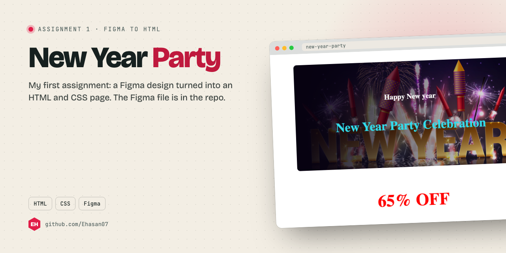

<p align="center"></p>

<p align="center"><a href="#screenshot">Screenshot</a> · <a href="#run-it">Run it</a></p>

## About

Assignment 1: a Figma design turned into a web page. The Figma source is in `Design/resources`.

## What it does

- Event hero with a big offer banner
- Layout matched to the Figma design
- Plain HTML and CSS, no framework

## Screenshot

<p align="center"></p>

## Built with

HTML · CSS · Figma

## Run it

No build step. Open `index.html` in a browser, or serve the folder:

```bash
npx serve .
```

---

<p align="center"><sub>Made by <a href="https://github.com/Ehasan07">S M Ehasanul Haque</a> · Dhaka, Bangladesh · <a href="https://ehasanlive.com">ehasanlive.com</a></sub></p>
